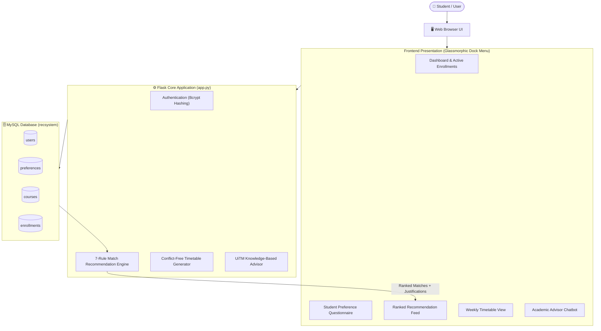
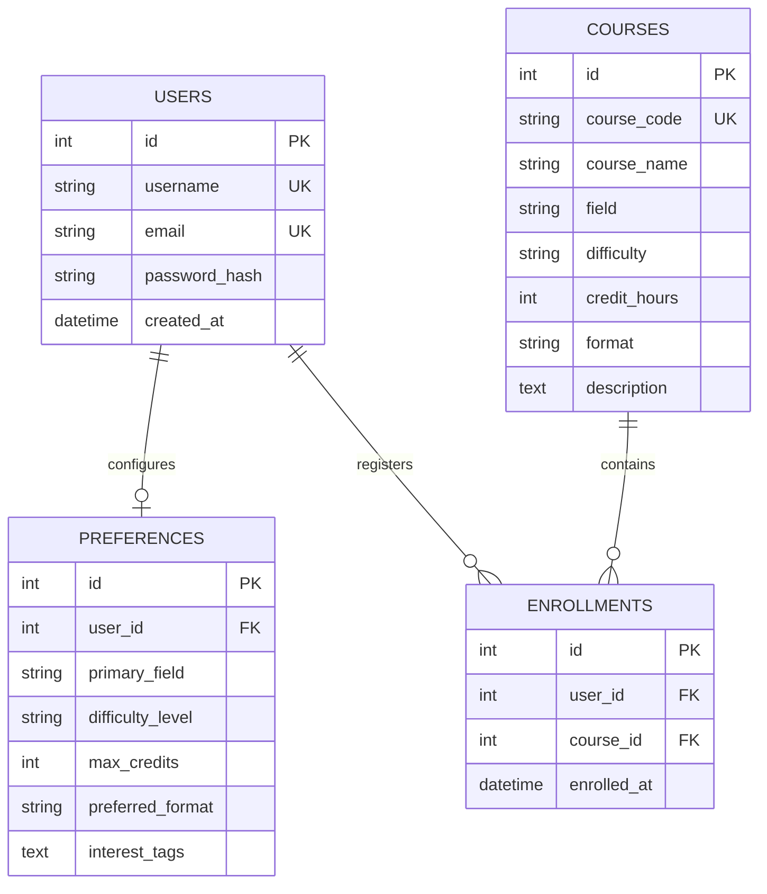

# 🎓 CourseRec — UiTM Intelligent Course & Timetable Recommendation System

[](https://www.python.org/)
[](https://flask.palletsprojects.com/)
[](https://www.mysql.com/)
[](https://en.wikipedia.org/wiki/Bcrypt)
[]()
[](LICENSE)

> **CourseRec (UiTM Recommender System)** is a full-stack academic advisement and planning platform built for university students at **Universiti Teknologi MARA (UiTM)**. Powered by a **7-Rule Match Recommendation Engine**, it analyzes individual student career aspirations, difficulty tolerances, and credit-hour constraints to deliver ranked course suggestions with transparent score justifications, automated clash-free timetable synthesis, and an interactive conversational academic advisor chatbot.

---

## 📌 Problem Background & Academic Context

Every semester, undergraduate students encounter significant decision paralysis during course registration periods:
* **Curriculum Navigation Overload:** Manually verifying prerequisites, faculty elective lists, and specialization tracks across hundred-page academic handbooks.
* **Timetable Scheduling Clashes:** Building a conflict-free lecture and tutorial schedule without overlapping time slots.
* **Lack of Transparent Guidance:** Standard portals offer course listings without contextual advice explaining *why* an elective fits a student's specific career goals.

**CourseRec** solves these challenges by providing:
* **Preference-Driven Profiling:** Captures desired fields (e.g., Software Engineering, AI & Data Science, Cybersecurity), target difficulty, learning formats, and workload capacity.
* **7-Rule Explainable Recommendation Engine:** Evaluates candidate courses across 7 distinct heuristic rules, providing clear percentage scores and reasoning for every suggestion.
* **Automated Timetable Generation:** Simulates student weekly schedules with instant clash detection and slot allocation.
* **Conversational Academic Advisor:** A knowledge-based chatbot trained on UiTM academic regulations, credit limits, and faculty guidelines.

---

## 🏗️ System Architecture & Recommendation Engine



---

## 🧠 The 7-Rule Recommendation Engine

The engine scores every candidate course out of 100 points across seven weighted evaluation criteria:

| Rule | Evaluation Criteria | Description & Match Justification | Weight |
|---|---|---|:---:|
| **Rule 1** | **Primary Field Alignment** | Measures alignment with student's primary academic focus (e.g., Computing, AI, Web) | 25 pts |
| **Rule 2** | **Secondary Interest Overlap** | Awards points for multi-disciplinary electives matching secondary career keywords | 15 pts |
| **Rule 3** | **Difficulty & Prerequisite Fit** | Validates difficulty tolerance against course intensity rating | 15 pts |
| **Rule 4** | **Credit Load Balance** | Ensures course credit hours fit cleanly within remaining semester credit cap | 15 pts |
| **Rule 5** | **Delivery Format Preference** | Matches preferred learning modality (In-person lectures, Hybrid, or Online lab) | 10 pts |
| **Rule 6** | **Career Path Synergy** | Synergizes course learning outcomes with target industry competencies | 10 pts |
| **Rule 7** | **Popularity & Peer Rating** | Factored score based on peer enrollment velocity and completion feedback | 10 pts |

---

## 🗄️ Database Architecture (MySQL)



---

## 📂 Project Directory Structure

```text
UITM_Recommender_System/
├── README.md                      # Comprehensive system documentation
├── requirements.txt               # Top-level dependencies for quick setup
├── .gitignore                     # Excludes Python bytecode (__pycache__), local .env
└── recsystem/                     # Application source package
    ├── app.py                     # Flask server, URL routing & controllers
    ├── config.py                  # Environment variable configuration loader
    ├── config.env.example         # Template for MySQL connection parameters
    ├── database_schema.sql        # Relational schema DDL definitions
    ├── seed_courses.py            # Automated UiTM course catalog seeder script
    ├── uitm_knowledge.py          # Academic advisor knowledge base facts
    ├── models/
    │   └── db.py                  # MySQL connection pool manager
    ├── services/
    │   ├── auth.py                # Bcrypt authentication and session security
    │   ├── recommender.py         # 7-rule scoring and ranking algorithms
    │   ├── timetable.py           # Schedule conflict detection and planning
    │   └── chatbot.py             # Rule-based conversational academic assistant
    ├── static/                    # Stylesheets and JavaScript client handlers
    │   ├── css/style.css
    │   └── js/
    │       ├── app.js
    │       └── chatbot.js
    └── templates/                 # Jinja2 HTML templates with dock navigation
        ├── base.html              # Bottom dock master layout
        ├── dashboard.html         # Current enrollments and progress overview
        ├── preferences.html       # Student preference survey form
        ├── recommendations.html   # Ranked course recommendations with scores
        ├── courses.html           # Full searchable course catalog
        ├── timetable.html         # Interactive weekly schedule grid
        └── chatbot.html           # Embedded AI advising dialogue
```

---

## 🛠️ Step-by-Step Installation & Setup

### 1. Prerequisites
* **Python:** Version 3.9, 3.10, or 3.11 (`python --version`).
* **Database Server:** [MySQL Server 8.0+](https://dev.mysql.com/downloads/installer/) (or XAMPP MySQL).

### 2. Clone the Repository
```bash
git clone https://github.com/akhmal02/UITM_Recommender_System.git
cd UITM_Recommender_System
```

### 3. Create a Virtual Environment (Recommended)
```bash
python -m venv .venv

# On Windows:
.venv\Scripts\activate

# On macOS/Linux:
source .venv/bin/activate
```

### 4. Install Dependencies
```bash
pip install -r requirements.txt
```

### 5. Initialize the MySQL Database
1. Open your MySQL client (MySQL Workbench, phpMyAdmin, or terminal CLI):
   ```bash
   mysql -u root -p
   ```
2. Create the database:
   ```sql
   CREATE DATABASE recsystem;
   ```
3. Import the initial database schema:
   ```bash
   mysql -u root -p recsystem < recsystem/database_schema.sql
   ```

### 6. Configure Environment Credentials
1. Copy the example configuration inside `recsystem`:
   ```bash
   cp recsystem/config.env.example recsystem/config.env
   ```
2. Open `recsystem/config.env` and update with your local MySQL credentials:
   ```env
   DB_HOST=127.0.0.1
   DB_PORT=3306
   DB_NAME=recsystem
   DB_USER=root
   DB_PASS=your_actual_mysql_password
   SECRET_KEY=your_generated_secret_key
   ```

### 7. Seed Initial Course Catalog Data
Populate the database with official UiTM curriculum courses:
```bash
cd recsystem
python seed_courses.py
```

### 8. Run the Application
```bash
python app.py
```

Open your browser and navigate to:
```text
http://127.0.0.1:5000/
```

---

## 👨‍💻 Author & Academic Attribution
* **Developer:** Muhammad Akhmal bin Mohamad Hussin ([@akhmal02](https://github.com/akhmal02))
* **Institution:** Universiti Teknologi MARA (UiTM)
* **Faculty:** College of Computing, Informatics and Mathematics
* **Specialization:** Intelligent Systems & Web Application Engineering
